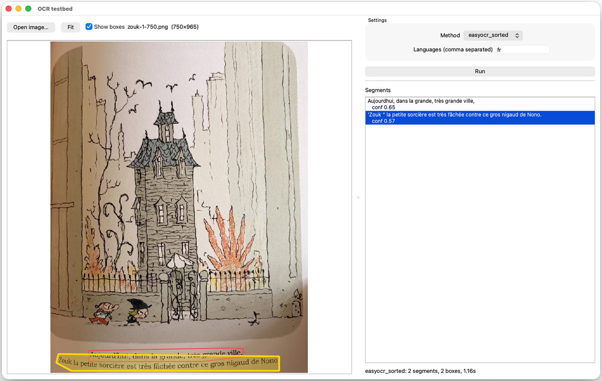

# Comic Reader

This is a demo project of a service that reads comics for kids.

You take a picture of a comics page with the mobile app,
and after a few seconds the app narrates it.

## Repo structure

This is a monorepo, containing all the code necessary to run the service.

## Running locally

```sh
docker compose up --build
```

- API: <http://localhost:8000> (docs at `/docs`)
- Postgres: `localhost:5432` (user/password/db: `comics`)
- Fake S3 (adobe/s3mock): `localhost:9090`, bucket `comics`

```sh
# 202
curl -i \
  -F "file=@fixtures/photos/schtroumpfs-1-square-4.png;type=image/png" \
  localhost:8000/comics   # 202

# 200 / 404
curl -i localhost:8000/comics/<id>

# SSE Stream
curl -N localhost:8000/comics/<id>/events
```

Tests: `docker compose run --rm --no-deps api pytest`

The `api/Dockerfile` has a `dev` target (used by compose)
and a default `prod` target (non-root, runs migrations then uvicorn) for ECR + Fargate.

## Image requirements (for the mobile app)

The service does no resizing: it expects the client to send an image ready for OCR.

- **Format:** PNG only (HEIC/JPEG from the phone camera must be converted).
- **Size:** resize to about **750px wide** before upload. Empirically, OCR (easyocr) works well at
  750px and starts breaking at 500px; full-resolution phone photos (4000-5700px) are several times
  slower for no gain.

## OCR test bed

`scratch/ocr/` is a throwaway workbench for choosing and tuning the OCR approach before it goes into
the API. It is separate from `api/` and not part of the service.



Pick an image, pick a method, tweak its settings and run it. The segments are shown the way the API
would store them, and methods that return bounding boxes (easyocr) get them overlaid on the image,
with a toggle to hide them. Selecting a segment highlights its box.

```sh
python3 -m venv .venv && .venv/bin/pip install -r scratch/ocr/requirements.txt
brew install tesseract tesseract-lang                  # only for the tesseract method
cd scratch/ocr
../../.venv/bin/python gui.py [image.png]              # desktop app
../../.venv/bin/python run.py -m easyocr_sorted        # batch over fixtures/photos (or any files/dirs)
../../.venv/bin/python ocr.py easyocr_sorted <image>   # one image, one method
```

Methods live in `scratch/ocr/methods/` (one module each, registered in `methods/__init__.py`):
`tesseract`, `easyocr`, and `easyocr_sorted` (easyocr plus the geometry-only line sorting in
`layout.py`).
